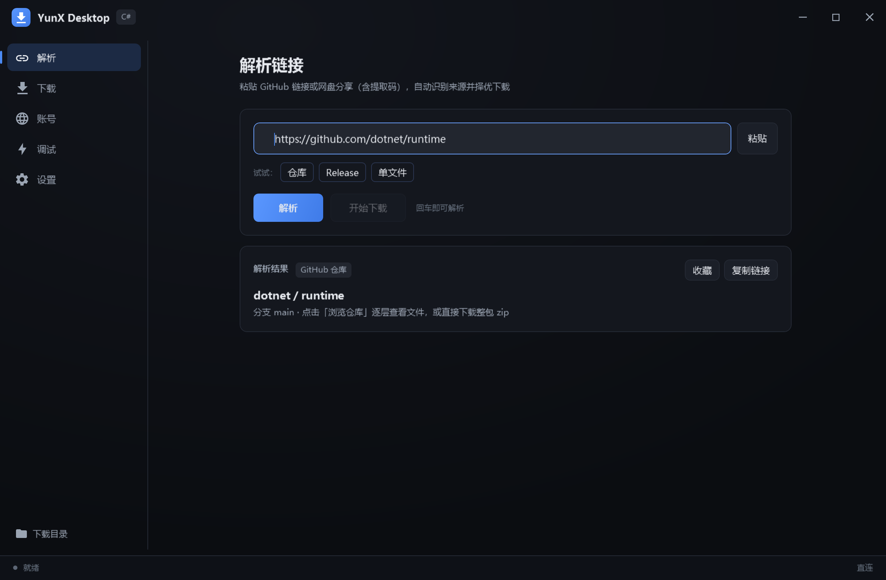
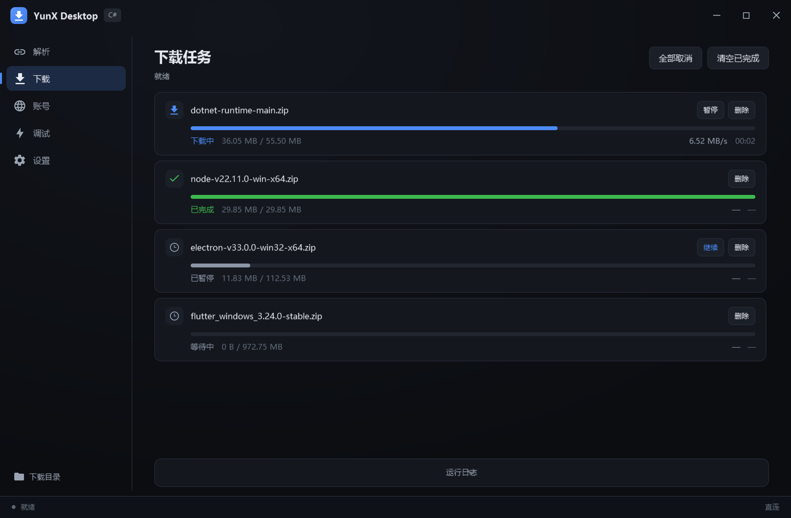

# YunX Desktop（C# 重构版）

把 [YunX-Desktop](https://github.com/tidain/YunX-Desktop)（Kotlin + Compose Desktop）的核心链路用
**C# / .NET 8 / WPF** 重写，并在下载引擎上补上了原版没有的几项优化。

---

## 项目来源与改造说明

### 上游项目

| 项 | 内容 |
|---|---|
| 项目名 | YunX Desktop |
| 源码 | https://github.com/tidain/YunX-Desktop |
| 技术栈 | Kotlin + Compose Desktop（JVM），233 个 `.kt` / 约 7 万行 |
| 协议 | **AGPL-3.0** |
| 本项目的角色 | **非官方重构版**，与上游作者无隶属关系 |

### 本项目的定位

把上游的**核心能力**用 C# / .NET 8 / WPF 重新实现，目标不是逐行翻译，而是：

1. 保留上游验证过的机制（多镜像择优、慢连接抢占、Range 降级容忍、API 缓存、401 自愈）；
2. 重做其中经不起推敲的部分（见下节"为什么重构"）；
3. 补上上游没有的能力（任务持久化、分片校验、磁力下载、README 渲染等）。

### 代码来源与协议边界（**重要，请先读**）

> 完整对照（含每处改造的理由、技术栈差异、已知差距）见
> [`docs/UPSTREAM-RELATION.md`](docs/UPSTREAM-RELATION.md)。

> 本项目**全部代码为独立实现，不包含上游源码副本**。
> `GuangYaDrive.cs` 等适配器是**按公开 HTTP 接口行为重写**的 C# 实现，不是 Kotlin 代码的翻译拷贝。
> 借鉴的对象是**技术思路与实测参数**（例如分片大小的经验值、慢连接判定窗口），这些属于方法论，
> 不构成对 AGPL 源码的复制。

**关于 AGPL-3.0 的判断责任**：AGPL 是强传染性协议。如果你打算把本项目与上游 Kotlin 代码
**混编、链接、或放在同一个可分发的产物里**，需要自行评估是否触发 AGPL 的传染要求
（尤其"通过网络提供服务"这一条）。本仓库仅声明自身为独立实现，不对你的组合方式负责。

### 许可协议

本项目采用 **[GNU AGPL-3.0](LICENSE)**，与上游保持同一协议。

```
YunX-Desktop-CSharp — 基于 YunX-Desktop 的 C# / WPF 重构版
Copyright (C) 2026  yamleaf

This program is free software: you can redistribute it and/or modify it under
the terms of the GNU Affero General Public License as published by the Free
Software Foundation, either version 3 of the License, or (at your option) any
later version.
```

**选择 AGPL-3.0 的理由**：本项目与上游在功能形态上高度同源（同一个产品的重构），
采用同一协议可以彻底消除"是否触发传染"的判断负担 —— 无论代码里是否残留上游痕迹，
分发与修改都合规。

**这对使用者意味着什么**：

| 你可以 | 你需要 |
|---|---|
| 自由使用、修改、分发 | 分发时**必须**提供完整源码 |
| 商用 | 保留版权声明与协议文本 |
| 部署成网络服务 | 使用者能获取到你修改后的源码（AGPL 第 13 条） |

若你需要**闭源商用**，AGPL 不适用 —— 那种情况需要另行取得授权，或仅将本项目作为
内部工具使用而不对外分发。

### 与上游的功能差异一览

| 维度 | 上游（Kotlin） | 本项目（C#） |
|---|---|---|
| 界面 | Compose Desktop | WPF（自绘标题栏、深色主题、种子色） |
| 下载引擎 | 3481 行，单镜像硬编码 | 多镜像测速择优 + 自适应分片 + 慢连接中位数判定 |
| 断点续传 | 只比对总大小 | ETag / Last-Modified 校验 + 区间元数据（含单流路径） |
| 任务持久化 | 有 | 有（SQLite，含请求头/网盘上下文/断点路径） |
| 分片校验 | 无 | 首尾哨兵抽查（可发现 pwrite 偏移错） |
| 磁力下载 | Gopeed 子进程 | Gopeed 子进程（复用同一思路，内核自动下载安装） |
| 网盘 | 10 个平台 | 10 个平台（独立重写） |
| 自动更新 | 有 | **已移除**（见下） |

### 为什么移除自动更新

上游的更新检测比对的是**上游自己的** Release tag。本重构版版本号从 `1.0.0` 重新起算，
拿它去比上游版本号必然得出"有新版本"的结论，而那些包是 **Kotlin 版** ——
用户点了会装成另一个程序。这比"没有更新功能"更有害，因此整体移除。

真要做自动更新，需要：自建 Release 仓库 + tag 与程序集版本同源 + 与单文件分发方式匹配的更新流程。

---

## 界面

**解析**：粘贴链接自动识别来源（GitHub 仓库 / Release / 单文件 / 网盘分享 / 磁力），
解析后直接看到结果卡片，可收藏、复制链接或逐层浏览仓库。



**下载**：多任务并行，实时速度 / 进度 / 剩余时间；任务行按状态给出可用操作
（进行中可暂停，暂停后可继续）。



> 截图由 `RenderTargetBitmap` 离屏渲染生成（2 倍采样），不含桌面背景与窗口阴影。

---

## 为什么重构

原项目 233 个 `.kt` / 约 7 万行，其中下载引擎 3481 行写得相当扎实（注释里带实测数据）。
但有几处结构性问题：

| 问题 | 表现 |
|---|---|
| 单镜像硬编码 | `MIRROR_PREFIX = "https://cdn.gh-proxy.org/"`，镜像挂了/变慢，速度直接受制于它 |
| 固定分片大小 | 先定块大小再算块数，尾块会退化成碎片（实测出现过 15 字节的块） |
| 无慢连接识别 | worker 绑定一条连接后，慢就一路慢到底 |
| 断点续传无 ETag 校验 | 只比对总大小，内容变了会拼出损坏文件 |

本重构把这四点全部重做，并保留原版值得学的机制（慢连接抢占、Range 降级容忍、API 缓存、401 自愈）。

---

## 相对原版的增强（按重要性）

### 1. 慢连接抢占（学自原版，但在原版基础上补了实测验证）

网盘 / CDN 普遍**按连接**限速，个别连接落在慢节点上。原版有看门狗机制但缺少量化证据，
本重构做了埋点对照。

我（Python 版）实测过一次 17MB / 8 线程下载的每块完成时刻：

```
#12 完成于 32.5s  单块速度 917 KB/s
#13 完成于 42.0s  单块速度  66 KB/s   ← 开始塌
#17 完成于 56.9s  单块速度  35 KB/s
#18 完成于 73.6s  单块速度  34 KB/s

12 个块在 32.5s 就全下完了 → 然后干等 41s
最后 2 块独占全程 31%
```

**根因**：worker 绑定一条连接，没有换连接的机制。

本实现的 `SlowChunkWatchdog` 每 5s 采样每路瞬时速度，低于
`max(12KB/s, 本任务平均单连接速/2)` 就置抢占标志；下载循环读到标志立即断开当前连接，
**已写字节全部保留**，剩余区间重新入队由别的连接续传。

关键语义：**抢占 ≠ 失败**。所以不退避、不判失败、不计入重试次数 —— 当失败处理会触发退避，反而更慢。

### 2. 块数反算 + 尾部收缩

```csharp
// 先定目标块数，再用 ceil 反算块大小
int targetChunks = workers * 2;
long chunk = (long)Math.Ceiling((double)total / targetChunks);
```

对比原版（先算 chunk 再算块数，且用整除）：

| | 17,840,399 B / 8 线程 |
|---|---|
| 原实现 | `chunk = total // 16 = 1,115,024`（floor）→ 17 块，**尾块 15 字节** |
| 本实现 | `chunk = ceil(total / 16) = 1,115,025` → 16 块，**尾块 1,115,024 B** |

尾部收缩：剩余 ≤ `workers × 块` 时把块压到 `remaining / workers`，让全部连接并行冲完最后一段。

日志里能直接看到收缩过程（同一份测试）：

```
16 块 × 1.06 MB → 剩余段逐步细分：952KB → 729KB → 427KB → 256KB → 128KB → 64KB
```

### 3. 无锁并发写

用 `RandomAccess.WriteAsync(SafeFileHandle, ...)` 而不是 `FileStream.Seek + Write`：

- 底层是 `pwrite` / `WriteFile(OVERLAPPED)`，**多线程写同一文件不需要锁**；
- 不移动共享文件指针，消除原实现的写锁串行化开销。

### 4. ETag / If-Range 校验（原版完全没有）

断点续传元数据记录 `ETag`，续传时以 `If-Range: "<etag>"` 发出：

- 服务器发现内容变了会返回 **200（全量）** 而不是 206（部分）；
- 收到 200 就**丢弃旧 part 重下**，绝不拼接。

这条防的是「版本更新但文件大小恰好没变」时静默拼出损坏文件。

### 5. 共享 HttpClient（原 Python 版踩过的坑）

所有分片复用同一个 `HttpClient` 的连接池。若每个分片 `new` 一个客户端，
每次请求都要重新 TCP + TLS 握手，8 线程下握手开销会吃掉大部分带宽。

同时禁用了自动解压（`Accept-Encoding: identity`）—— Range 是按**压缩前**字节算偏移的，
一旦让 HttpClient 解压，写入位置全错。

### 6. 多镜像测速择优

并发探测所有线路，按**稳态吞吐**排序。原实现用 64KB 样本测速会选错线路（测到的是握手延迟而非带宽），
这里改为 ~768KB 样本 + 从首块之后开始计时：

```csharp
long steadyBytes = got - firstChunkLen;
double steadySpan = elapsed - latency;   // 剔除 TCP/TLS 握手
speed = steadyBytes / steadySpan;
```

失败线路进入 5 分钟冷却，避免反复在必死线路上浪费时间。排序结果按 URL 类别缓存 3 分钟。

### 7. 私有仓库不走镜像（原版遗漏）

实测确认：**镜像不转发 `Authorization` 头**。

```
直连 api.github.com  → 401 {"message": "Bad credentials"}
镜像 gh-proxy.com    → 200 {...}        ← 匿名内容
```

后果有两层：
1. 用户填错 Token 收不到任何提示（镜像"帮"他成功了）；
2. **私有仓库走镜像必然失败**，且报错莫名，填对 Token 也没用。

本实现：有 Token 时 API **只走直连**；遇到 401 自动清空 Token 并提示用户。

### 8. 其他

| 项 | 说明 |
|---|---|
| 错峰建连 | 第 i 路首请求延迟 `min(i,8)×25ms`（≤200ms），摊平 TCP/TLS 突发，降低触发镜像限流概率 |
| 令牌桶限速 | 等待在锁外进行，不会因为睡眠占着连接（睡眠式限速会造成周期性集体停顿） |
| 区间级断点 | `IntervalSet` 记录已完成字节区间并自动合并，乱序完成也能精确续传 |
| 目录穿越防护 | 原版 `safe_filename` 只替换非法字符，本实现额外拒绝 `..`/绝对路径/盘符并二次校验包含关系 |
| 原子元数据 | 临时文件 + `File.Move(overwrite)`，掉电不会留下半截 JSON |
| 单文件自包含 | `PublishSingleFile` + `SelfContained`，目标机不需要装 .NET 运行时 |

---

## 实测对比

同一台机器、同一个文件（yt-dlp.exe，17.01 MB，8 线程）：

| 指标 | Python 版（GitHubFastDL） | **C# 版（本项目）** |
|---|---|---|
| 耗时 | 73.7 s | **9.5 s** |
| 平均速度 | 236 KB/s | **1.80 MB/s** |
| 分片数 | 17 块（含 15 字节尾块） | 16 块（尾块 1.06 MB） |
| 收尾占比 | **31%** | **3%** |
| 连接复用 | 每次新建 | 全程共享连接池 |

> 注意：两次测量的网络状况不同，绝对速度不可直接比较；
> **收尾占比**才是可比指标 —— 它量化了"最后一点特别慢"的程度。

---

## 结构

```
src/
  YunX.Core/          下载引擎、镜像择优、网络层（无 UI 依赖）
    Download/         DownloadEngine / ChunkPlanner / SlowChunkWatchdog
                      IntervalSet / PartMetadata / RemoteProbe / SpeedLimiter
    Mirrors/          Mirror / MirrorRegistry / MirrorProbe / MirrorPool
    Net/              HttpClientProvider / HostsBypass
    Util/             Humanize / FileNamePolicy
  YunX.GitHub/        GitHub 链接解析、API 客户端、内容解析
  YunX.Desktop/       WPF 界面（MVVM，手写，无额外框架依赖）
  YunX.Smoke/         验证程序（离线断言 + 真实网络 + 收尾分析）
```

Core 与 GitHub 层完全不含 UI 依赖，便于将来接网盘或换 UI 框架。

---

## 构建与运行

### 一键编译（推荐）

需要 .NET 8 SDK。双击 `build.bat`，或在命令行：

```bat
build.bat            :: 编译 Release 并发布单文件到 publish\
build.bat debug      :: 只编译 Debug（改代码后快速验证）
build.bat test       :: 编译 + 跑全部离线断言
build.bat clean      :: 清理所有 bin / obj / publish
```

脚本会自动查找 `dotnet`（环境变量 → PATH → 常见安装位置），
并在发布前检查程序是否正在运行 —— 强行覆盖会得到一个晦涩的
`MSB4018: GenerateBundle 意外失败`，脚本会直接告诉你是"请先关闭程序"。

产物：`publish\YunX-Desktop.exe`（约 70 MB，自包含单文件，目标机无需 .NET）
+ `publish\LICENSE`。

### 手动构建

```powershell
# 开发运行
dotnet run --project src/YunX.Desktop

# 自包含单文件发布（目标机无需 .NET）
dotnet publish src/YunX.Desktop -c Release -o publish
```

### 重新生成图标

图标是代码生成的（`tools/make-icon.py`），不是一个静态 PNG：

```bash
pip install pillow
python tools/make-icon.py
# → src/YunX.Desktop/Assets/app.ico（16/24/32/48/64/128/256 七个尺寸）
# → tools/icon-preview.png（各尺寸预览）
```

改配色或形状直接改脚本再跑一遍即可；每个尺寸都从 1024 母版重采样，
不是逐级缩放，所以 16px 下边缘也不糊。

### 验证

```text
# 离线断言（258 项，秒级；含下载引擎端到端）
dotnet run --project src/YunX.Smoke

# 界面链路断言（40 项：解析 → 入队 → 下载 → 完成）
dotnet run --project src/YunX.Desktop -- --selftest

# 追加真实网络验证（线路测速、链接解析、17MB 下载、收尾分析）
dotnet run --project src/YunX.Smoke -- live

# 追加慢连接抢占 A/B 对照
dotnet run --project src/YunX.Smoke -- live tail
```

验证覆盖：分片规划回归、区间集合、路径安全、15 种链接解析、线路拼装、
hosts 绕过、联网模式探测、真实下载（MD5/魔数/残留文件）、收尾塌缩量化。

**下载引擎端到端**（本地裸 `TcpListener` 伪造 HTTP 服务，不连外网）：

| 用例 | 验的是什么 |
|---|---|
| 4MB / 4 线程 | 8 块 206 分片、内容哈希一致、无 .part 残留 |
| 自定义请求头 | `Referer` / `Cookie` 真的发到服务端（网盘直链的前提） |
| 探测后 Range 被忽略 | 整任务降级单流，且不会把全量响应拼在分片后面 |
| 直链随即 403 | **有界失败**（秒级报错），不是永久卡在「下载中」 |
| 取消 | 抛「已取消」、保留 .part + 断点、不误删目标文件 |
| 预置半个 part | 续传 `Resumed=true`、内容正确、只请求剩余区间 |

另有慢连接抢占判定（只抢慢的 / 冷却期不重复抢 / 收尾分支）、令牌桶限速、
断点元数据 8 线程并发写、分片哨兵摘要（含「数据错位必须被检出」）、
64 路并发同名不撞路径的测试。

---

## 已实现 / 未实现

**已实现**

- GitHub：仓库 / 单文件 / 目录 / Release（资产多选）/ 归档 / gist / `owner/repo` 简写
- **GitHub 仓库文件树浏览**：解析结果里点「浏览仓库」，可逐层进入目录、点文件直接入队
- **README 渲染预览**：GFM 标题/代码/列表/引用/表格/行内格式，相对图片自动改写为 raw 地址
- **磁力下载（Gopeed 引擎）**：识别 `magnet:` 链接 → 自动下载并安装 Gopeed 官方内核
  （约 38 MB，走镜像加速）→ 子进程引擎负责 DHT/tracker/peer 调度，进度实时同步到任务列表
- 下载：多镜像择优、分块多线程、慢连接抢占、**断点续传（含单流路径）**、Range 降级、限速、分片校验、可选全文件 SHA-256
- **10 个网盘**：夸克 / UC / 迅雷 / 百度 / 139 / 123 / 115 / 蓝奏 / 光鸭 / 星海口令，含目录逐层浏览
- **网盘主动操作**：目录分页「加载更多」、登出（清除本机 Cookie）、认证备份导出/导入
- **账号与凭证**：网盘 Cookie 与 GitHub Token 均走 AES-GCM 加密落盘（主密钥由 DPAPI 保护）
- **任务生命周期**：暂停 / 继续 / 取消 / 删除、排队并发控制、**持久化与重启恢复**（含请求头、网盘上下文、断点路径）
- 网络：DoH 绕过 hosts 劫持、直连/代理自动探测、可选 HTTP/2
- 界面：任务列表、实时进度、Release 资产多选、设置面板、运行日志、解析历史、链接收藏、完成通知、系统托盘

**仍未实现**

- Windows 通知中心的**任务栏进度聚合**（当前用托盘气泡提示完成）
- GFM Markdown 渲染（README 预览以纯文本呈现）
- 自动更新 —— 已**主动移除**：原实现去比对上游 Kotlin 项目的 Release tag，
  与重构版（版本号从 1.0.0 重新起算）没有可比性，必然误导用户去装另一个程序。
  真要做需要：自己的 Release 仓库 + tag 与程序集版本同源 + 与单文件分发方式匹配的更新流程。

架构上给新来源留了位置：新增网盘只需实现 `ICloudDrive`（解析 → `ResolvedContent`），
下载与网络层无需改动。

---

## 已知限制

- **仓库 zip（codeload）不支持 Range**，会走单流。这是 GitHub 服务端动态打包的特性，非实现问题。
  本实现会自动识别并降级，日志里明确提示"单流模式"。
- 慢连接抢占需要至少 15s 才能判定（`MinAgeMs`），短任务来不及触发；这是刻意的——
  太早判定会把正常爬坡的连接误杀。
- 镜像可用性随地区/时间变化很大。内置线路表标注了实测状态，随时可在设置里调整。
